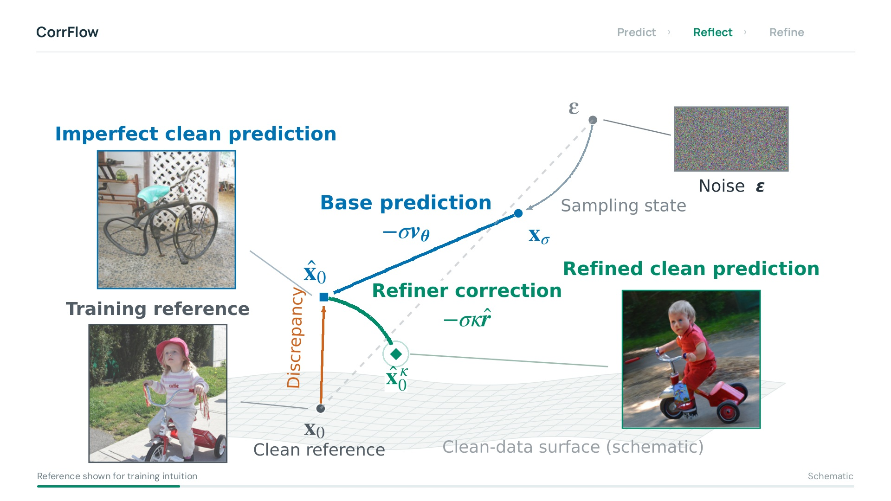
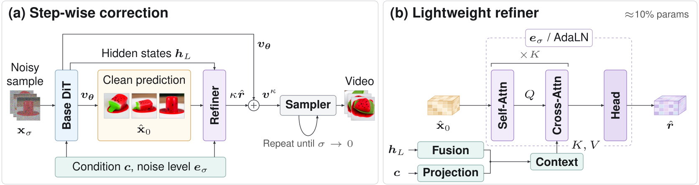

<h1 align="center">CorrFlow: Self-Correcting Flow Matching</h1>

<p align="center">
  <a href="https://fogradio.github.io/">Hangwei Zhang</a><sup>1</sup> &nbsp;
  <a href="https://www.linkedin.com/in/nathanrouille/">Nathan Rouillé</a><sup>1,2</sup> &nbsp;
  <a href="https://physicalvision.github.io/people/~chuanxia">Chuanxia Zheng</a><sup>1</sup>
</p>

<p align="center">
  <sup>1</sup> PVG, Nanyang Technological University<br>
  <sup>2</sup> Télécom Paris, Institut Polytechnique de Paris
</p>

<p align="center">
  <a href="https://fogradio.github.io/corrflow-project/"><b>Project Page</b></a> ·
  <b>Paper</b> ·
  <b>Model</b>
</p>

**CorrFlow learns to correct its own predictions for image and video generation.** A lightweight refiner revises the base model's velocity before each sampling update.

<p align="center">
  <a href="https://fogradio.github.io/corrflow-project/#method">
    
  </a>
  <br>
  <em>Predict, reflect, refine. Click to watch the method video.</em>
</p>

## Method

The refiner predicts a velocity residual from the base model's clean prediction, hidden states, conditioning, and noise level. Each correction reuses the same base-model forward pass, adding one refiner evaluation per step. The clean reference shown above is used only during training.

<p align="center">
  
</p>

## Citation

```bibtex
@misc{zhang2026corrflow,
  title  = {CorrFlow: Self-Correcting Flow Matching},
  author = {Zhang, Hangwei and Rouillé, Nathan and Zheng, Chuanxia},
  year   = {2026},
  url    = {https://fogradio.github.io/corrflow-project/}
}
```

## Release Plan

- [ ] Release image generation training and inference code.
- [ ] Release image generation checkpoints.
- [ ] Release video generation training and inference code.
- [ ] Release video generation checkpoints.
